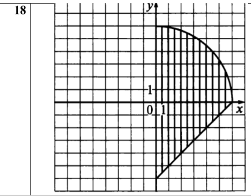
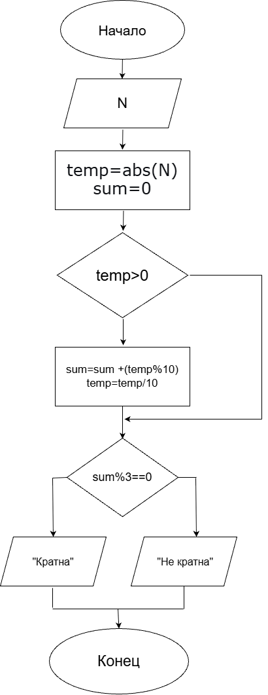
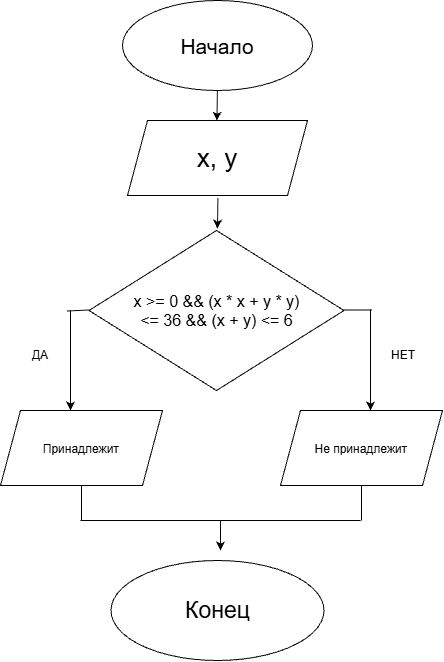
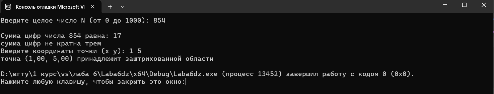

 <h1>Домашнее задание к работе 6 </h1>

## Условие задачи
1) Дано число N (N<1000). Написать программу,которая проверяет является ли сумма цифр введенного числа кратна трем. 
2) Составить программу, которая проверяет принадлежит ли заданная пользователем точка с координатами (x; y) заштрихованным областям, показанным на рисунке.

## Решение задачи

1. <b>Алгоритм и блок-схема </b>  
<i>Алгоритм 1</i> 
1) Начало 
 2) Объявление переменных: int N, temp, sum = 0; 
 3) Ввод числа N 
 4) temp = abs(N) (берем модуль числа, чтобы корректно работать с отрицательными значениями) 
 5) Цикл while (temp > 0): 
 5.1) sum = sum + (temp % 10) (добавляем последнюю цифру к сумме) 
 5.2) temp = temp / 10 (отбрасываем последнюю цифру) 
 6) Условие if (sum % 3 == 0): 
 6.1) Если да — вывод "сумма цифр кратна трем" 
 6.2) Если нет — вывод "сумма цифр не кратна трем" 
 7) Конец 
 <i>Блок-схема 1</i> 
 
<i>Алгоритм 2</i> 
1. Начало  
1. Объявление переменных: double x, y; 
1. Ввод координат точки x и y 
1. Проверка сложного условия: 
if (x >= 0 && (x * x + y * y) <= 36 && (x + y) <= 6) 
1. Если условие истинно (Да): вывод "точка принадлежит заштрихованной области" 
1. Если условие ложно (Нет): вывод "точка не принадлежит заштрихованной области" 
1. Конец 

<i>Блок-схема 2</i> 

 

2. <b>Реализация программы</b> 
#define _CRT_SECURE_NO_WARNINGS  
#include <stdio.h> 
#include <locale.h> 
#include <math.h> 
int main(void) { 
    z1(); 
    z2(); 
} 
int z1(void) { 
    setlocale(LC_ALL, ".UTF8"); 
    int N; 
    printf("Введите целое число N (от 0 до 1000): "); 
    scanf("%d", &N); 
    int temp = abs(N); 
    int sum = 0; 
    while (temp > 0) { 
        sum += temp % 10; 
        temp /= 10; 
    } 
    printf("\nСумма цифр числа %d равна: %d\n", N, sum); 
    if (sum % 3 == 0) { 
        printf("сумма цифр кратна трем\n"); 
    } 
    else { 
        printf("сумма цифр не кратна трем\n"); 
    } 
    return 0; 
} 
 
int z2(void) { 
    setlocale(LC_ALL, ".UTF8"); 
    double x, y; 
    //контрольныве примеры: (1 0) да, (6 6) нет, (1 -2) да, (6 3) нет 
    printf("Введите координаты точки (x y): "); 
    if (scanf("%lf %lf", &x, &y) != 2) { 
        printf("Ошибка ввода!\n"); 
        return 1; 
    } 
    if (x >= 0 && (x * x + y * y) <= 36 && (x + y) <= 6) { 
        printf("точка (%.2f, %.2f) принадлежит заштрихованной области\n", x, y); 
    } 
    else { 
        printf("точка (%.2f, %.2f) не пренадлежит заштрихованной области\n", x, y); 
    } 
    return 0; 
} 

3. <b>Результат работы программы</b> 
 

4. <b>Информация о разработчике</b> 
Выполнила работу: Кучеренко Дарья, гр.бИЦТ-261, вариант 18